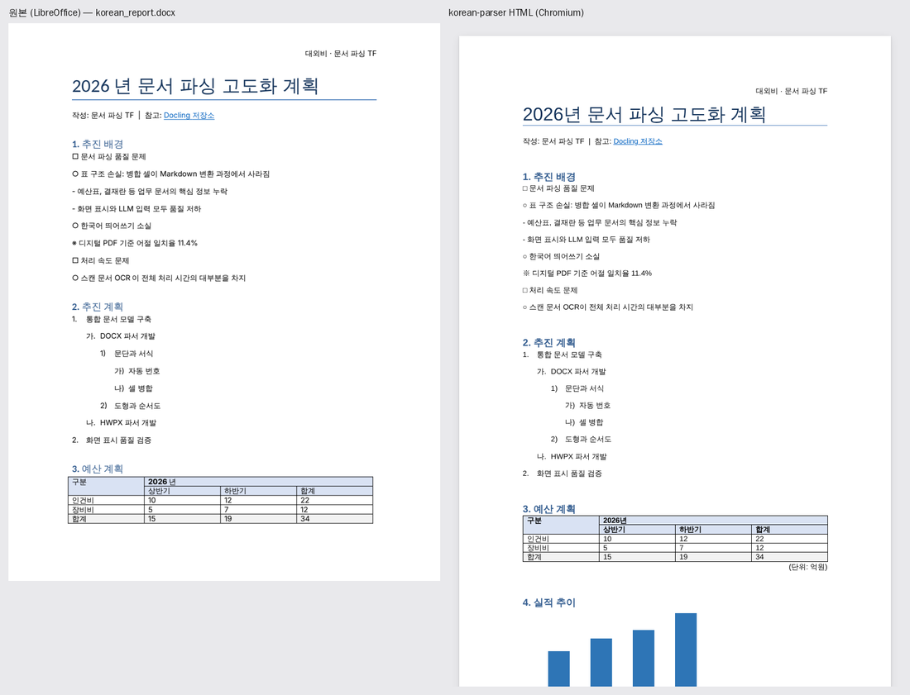
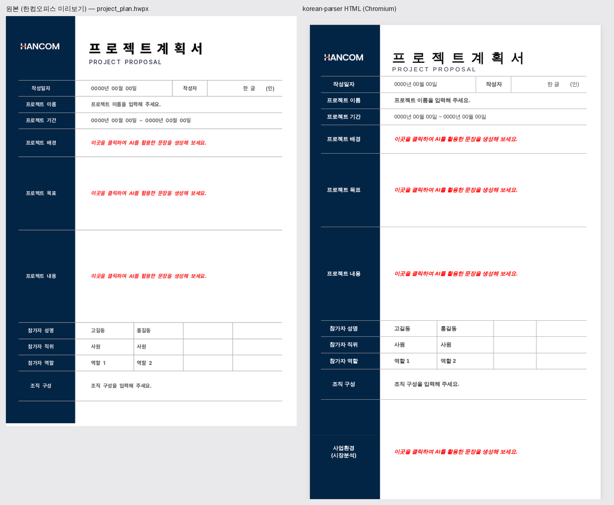
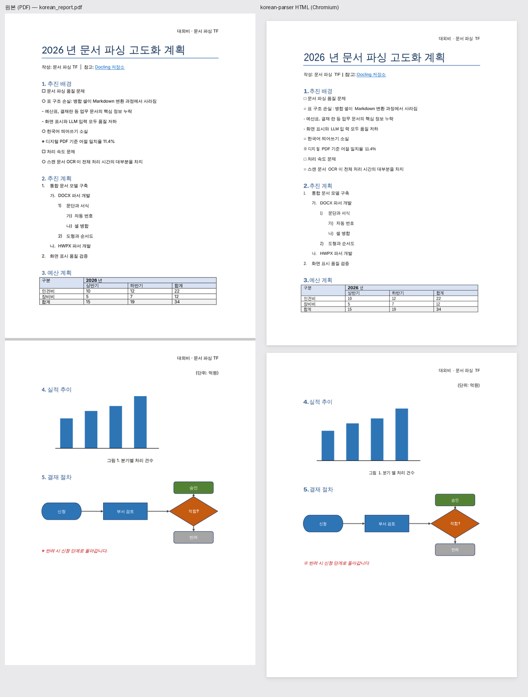

# korean-parser-all

한국어와 한글 문서에 특화된 문서 파서입니다.

- **하나의 입구**: 문서 형식에 상관없이 `parse(파일)` 하나로 같은 결과 형식(통합 문서 모델)을 얻습니다.
- **후처리 없는 HTML**: Markdown을 거치지 않고 문서 모델에서 바로 HTML을 만들어, 표 병합·서식·도식·차트가 원본처럼 보입니다.
- **LLM용 텍스트**: 같은 모델에서 LLM이 읽기 좋은 텍스트(병합 표는 HTML, 도식은 연결 관계)를 만듭니다.
- **한국어 특화**: 개조식(□ ○ -)·한글 번호(가. 나.) 계층, 문자 정규화, PDF 띄어쓰기 복원.



이 프로젝트는 **파서(엔진)**까지만 맡습니다. 분류·임베딩·검색·정보 추출은 결과물(JSON, 조각, HTML)을 받는
후속 프로젝트의 몫입니다. 나누는 기준과 쓰는 쪽과의 약속(형식 버전, 결정성)은 [docs/SCOPE.md](docs/SCOPE.md)에 있습니다.

## 지원 형식

| 형식 | 상태 | 방식 |
|---|---|---|
| DOCX | ✅ v0.2 | XML 규칙 파싱 (AI 없음) |
| HWPX | ✅ v0.3 | XML 규칙 파싱 (AI 없음) |
| PDF | ✅ v0.4 | Docling(레이아웃·표·OCR) + PDF 텍스트 레이어로 서식 복원 + 한국어 후처리 |
| HWP (5.0) | ✅ v0.8 | 바이너리 레코드를 HWPX 모양으로 옮겨 HWPX 변환을 그대로 씀 (AI 없음) |
| PPTX | ✅ v0.11 | XML 규칙 파싱 (AI 없음) |
| XLSX | ✅ v0.11 | XML 규칙 파싱 (AI 없음) |

**DOCX**: 제목 계층, 글자 서식(굵게·색·크기·밑줄·대문자), 문단 서식(정렬·들여쓰기·간격·테두리),
자동 번호(가나다·원문자 등 한국어 형식 포함), 표(가로·세로 병합, 배경, 테두리, 중첩 표),
이미지, 도형·순서도(SVG로 렌더링), 차트(막대·꺾은선·원형 등), 떠 있는 개체 배치,
각주·미주, 머리말·꼬리말, 하이퍼링크, 양식 체크박스, 기호 글꼴.

**HWPX (한글)**: 글자 모양(자간·형광펜 포함), 문단 모양(여백·줄 간격·문단 테두리), 개요 번호(→ 제목 계층),
문단 번호·글머리표(1. → 가. → 1) → 가), ①, ㉮ 등), 표(병합, 칸별 테두리·배경, 떠 있는 표),
그리기 개체(사각형·타원·호·선·다각형·곡선·연결선·묶음 개체, 회전·뒤집기 포함), 그림·그림 채우기,
쪽 배경, 수식(원문 수식 스크립트), 차트, 머리말·꼬리말, 각주, 하이퍼링크, 변경 추적(삭제 내용 제외), 양식 개체.



**PPTX**: 슬라이드마다 쪽 나누기, 제목 자리 표시자 → 제목, 내용 자리 표시자 → 단계 있는 글머리 목록(글머리 기호·자동 번호),
표(병합, 칸 배경·테두리), 차트, 그림(대체 텍스트), 묶음 안 글상자, SmartArt 글, 발표자 메모. 읽는 순서는 제목 다음 빈 띠로
나눠(XY 자르기) 두 단·카드 배치를 단마다 읽습니다. 자리 표시자 없이 글상자로 만든 슬라이드(PptxGenJS 등)는 되풀이되는
바닥글·쪽 번호를 꼬리말로 옮기고, 위쪽 가장 큰 글씨에 제목 추정(`heading_guess`)을 붙입니다.

**XLSX**: 시트마다 시트 이름 제목 + 쓰인 범위의 표 하나. 병합 칸, 굵은 글씨, 칸 배경, 열 너비. 값은 Excel 화면 모양대로
(천 단위 쉼표, 소수 자릿수, 백분율, 날짜). 수식은 저장된 계산 결과(없으면 수식). 숨긴 시트도 넣고 경고를 남깁니다.
시트의 차트도 읽습니다 (값 캐시가 없으면 가리키는 칸의 값으로).

**HWP 5.0 (한글 바이너리)**: 한글 2002 이후의 .hwp 파일. 글자·문단 모양, 개요·문단 번호, 글머리표, 표(병합, 칸별
테두리·배경, 중첩 표), 그림, 그리기 개체(사각형·타원·호·선·다각형·곡선·연결선·묶음, 글상자 → SVG),
수식(원문 스크립트), 머리말·꼬리말, 각주, 하이퍼링크, 문서 정보(제목·지은이·날짜)를
HWPX와 같게 읽습니다. 암호가 걸린 문서와 배포용 문서는 열 수 없다고 안내합니다.

**PDF**: Docling으로 제목·문단·목록·표·그림 영역과 읽기 순서를 찾고, 글과 띄어쓰기는 PDF 텍스트 레이어에서
그대로 읽습니다. 표 구조는 PDF에 그어진 선(괘선)으로 읽어 병합 칸이 많은 공공 문서 표(평가표, 서식)도 원본과 같게 나옵니다. 글자 크기·굵기·색도 텍스트 레이어에서 읽어 서식과 제목 단계를 되살립니다. Docling이 그림 하나로 잘못 묶은 영역은
실제 그래픽 개체 위치로 나눠 캡션·제목을 본문으로 되돌리고, 도식 안 글자는 LLM용으로 따로 뽑습니다.
여러 쪽에 반복되는 글만 머리말·꼬리말로 인정하고, 모든 블록에 쪽 번호와 좌표가 붙습니다.
텍스트 레이어가 없는 스캔 PDF는 OCR(RapidOCR 한국어)로 읽습니다. OCR이 빠뜨린 띄어쓰기와 개조식 기호(□ ○)는
쪽 그림의 글자 사이 빈칸과 기호 모양으로 되살립니다.

PDF의 HTML은 두 가지 배치로 만들 수 있습니다.

| 배치 | 방식 | 용도 |
|---|---|---|
| `fixed` (PDF 기본) | 글자를 지운 원본 쪽을 바탕 그림으로 깔고, 실제 글을 원래 위치·크기·색으로 올림 (가려진 글·겹쳐 그린 글은 제외) | 원본과 똑같은 화면. 글은 검색·복사되고 블록 id로 LLM 답변과 연결 |
| `flow` | 문서 구조대로 다시 흐르게 배치 | 모바일, 접근성, 편집 |



## 사용법

```bash
pip install -e ".[dev]"
python -m korean_parser convert 문서.docx -o out/      # out/문서.html, 문서.llm.md, 문서.json
python -m korean_parser convert 보고서.hwpx -o out/
python -m korean_parser convert 공고문.pdf -o out/ --layout fixed   # PDF는 pip install -e ".[pdf]" 필요
```

```python
from korean_parser.parsers import parse
from korean_parser.render.html import render_html
from korean_parser.render.llm import render_llm

doc = parse("보고서.hwpx")          # 통합 문서 모델 (pydantic, JSON 저장 가능). DOCX도 같은 방법

html = render_html(doc)             # 한 파일로 완결된 HTML (CSS·이미지 포함)
text = render_llm(doc)              # LLM 입력용 텍스트
```

LLM 출력 예 ([`tests/fixtures/korean_report.docx`](tests/fixtures/)):

```markdown
# 2. 추진 계획  <!-- b12 -->
1. 통합 문서 모델 구축  <!-- b13 -->
  가. DOCX 파서 개발  <!-- b14 -->
    1) 문단과 서식  <!-- b15 -->

<table><tr><td rowspan="2">구분</td><td colspan="3">2026년</td></tr>...</table>  <!-- b22 -->

[도식: 결재 처리 순서도]  <!-- b50 -->
- 신청
- 부서 검토
- 적합?
연결:
- 신청 → 부서 검토
- 적합? → 승인
```

`<!-- b12 -->`는 블록 id입니다. HTML의 `data-kp-id`와 같아서, LLM 답변의 근거를 화면에서 바로 강조할 수 있습니다.

### 검색용 조각 (RAG)

글자 수가 아니라 문서 구조로 자릅니다. 조각 크기는 쓰는 쪽(임베딩 모델, 검색 방식)에 맞춰 정합니다.

```python
from korean_parser.chunk import chunk

for c in chunk(doc, max_tokens=500):                 # count_tokens=내 토크나이저 도 넘길 수 있음
    vector_db.add(text=c.contextual_text(), metadata=c.metadata())
```

- **제목 경로**: 제목 스타일뿐 아니라, 한글 문서에서 흔한 '굵고 큰 번호 문단'(Ⅰ. 사업 개요 → 1. 제안개요 → ① …)도
  장·절 제목으로 인식합니다. 목차 줄은 제외합니다. 같은 문서의 HWPX와 DOCX 변환본이 같은 경로를 냅니다.
  문서 모델에서는 이런 문단을 제목으로 바꾸지 않고 `Paragraph.heading_guess`(추정 단계와 판단 근거)로 표시만 합니다.
- **경계**: 장이 바뀌면 반드시 끊고, 작은 절은 같은 장 안에서 이웃과 합칩니다. 합친 조각의 경로는 공통 상위 제목입니다.
- **표**: 통째로 둡니다. 상한을 넘는 표만 행 단위로 나누고, 머리 행과 세로 병합 칸('평가부문' 등)을 조각마다 복사해 문맥을 지킵니다.
- **제목 상자·글상자**: 한 칸짜리 표, 배치용 표, 글상자 안의 글과 표는 본문처럼 풀어서 자릅니다.
- **메타데이터**: 블록 id(HTML `data-kp-id`와 같음), 쪽 번호·좌표(PDF), 문서 정보, 조각 안에서 참조한 각주.

예: 제안요청서 작성 예시의 10쪽짜리 평가표를 나눈 첫 조각 (`contextual_text()`)

```text
[Ⅵ. 제안안내 사항 > 2. 제안 평가 관련 사항]
<table><tr><td>평가부문</td><td>평가항목</td><td>평가기준</td>...</tr><tr><td rowspan="4">전략<br>및<br>방법론<br>(15점)</td>...

metadata(): {"chunk_id": "c31", "heading_path": ["Ⅵ. 제안안내 사항", "2. 제안 평가 관련 사항"], "block_ids": ["b1009"],
             "kinds": ["table"], "tokens": 490, "doc_source_name": "rfp_example.hwpx", "doc_source_format": "hwpx", ...}
```

명령줄: `python -m korean_parser convert 문서.hwpx -o out/ --formats chunks --max-tokens 500` → `out/문서.chunks.jsonl`

토큰 수는 기본으로 어림값(한글 음절당 1토큰)을 씁니다. 표 한 행의 칸 하나에 아주 긴 글이 든 경우가 아니면 상한을 넘지 않습니다.

## 구성

| 경로 | 내용 |
|---|---|
| [`korean_parser/ir.py`](korean_parser/ir.py) | 통합 문서 모델 |
| [`korean_parser/parsers/`](korean_parser/parsers/) | 단일 입구 `parse()`와 형식별 파서 (DOCX, HWPX, PDF) |
| [`korean_parser/render/`](korean_parser/render/) | HTML, LLM 텍스트, SVG(도형·차트) 렌더러 |
| [`korean_parser/chunk.py`](korean_parser/chunk.py) | 구조 기반 청크 도구 (RAG용) |
| [`korean_parser/enrich.py`](korean_parser/enrich.py) | 한국어 처리 레이어를 문서 모델에 적용 |
| `korean_parser/normalize.py`, `spacing.py`, `outline.py` | 문자 정규화, 띄어쓰기 복원, 개조식 계층 인식 |
| [`docs/ARCHITECTURE.md`](docs/ARCHITECTURE.md) | 설계와 단계별 계획 |
| [`docs/SCOPE.md`](docs/SCOPE.md) | 이 프로젝트의 범위, 후속 프로젝트로 넘기는 일, 쓰는 쪽과의 약속 |
| [`benchmarks/eval/`](benchmarks/eval/) | 정답 세트와 요소별 평가 (글자 오류율, 어절 F1, 읽기 순서, 제목, 표 TEDS). Docling 기본 출력과 비교 |
| [`benchmarks/visual-compare/`](benchmarks/visual-compare/) | 원본 vs HTML 시각 비교 |
| [`benchmarks/corpus/`](benchmarks/corpus/) | 웹 문서 180개(DOCX 131, HWPX 49) 일괄 실행. 정상 문서 164개 전부 성공. 나라장터 첨부파일 수집 스크립트 |
| [`benchmarks/korean-postprocess/`](benchmarks/korean-postprocess/) | PDF 띄어쓰기 복원 평가 (F1 0.459 → 0.991) |
| [`benchmarks/docling-cpu/`](benchmarks/docling-cpu/) | Docling CPU 속도 벤치마크 |

## 한국어 처리

```python
from korean_parser import SpacingFixer, detect_outline, outline_to_markdown

fixer = SpacingFixer()
fixer.respace("본문서는 2026 년도사업추진방향과예산계획을설명합니다.", reset=True)
# '본 문서는 2026년도 사업 추진 방향과 예산 계획을 설명합니다.'

fixer.join_lines(["담당 부서는 진행 상", "황을 매주 보고합니다."])
# '담당 부서는 진행 상황을 매주 보고합니다.'

print(outline_to_markdown(detect_outline(["□ 추진 배경", "○ 품질 문제", "- 표 구조 손실"])))
# - □ 추진 배경
#   - ○ 품질 문제
#     - - 표 구조 손실
```

PDF는 Docling으로 변환한 뒤 후처리를 적용할 수 있습니다 (`pip install -e ".[docling]"`).

```python
from docling.document_converter import DocumentConverter
from korean_parser.docling_adapter import postprocess_docling

doc = DocumentConverter().convert("문서.pdf").document
postprocess_docling(doc)
```

형태소 분석기 [Kiwi](https://github.com/bab2min/Kiwi)(kiwipiepy, Apache-2.0)를 사용합니다.

HWPX를 LLM 텍스트로 바꿀 때는 한글 문서의 관행을 반영합니다. 제목 상자나 강조 상자로 쓰이는
1열짜리 표는 표가 아닌 글로 풀고, 직접 입력한 번호(1. 가. 1))와 개조식 기호는 계층에 맞춰 들여씁니다.

## 알려진 한계

공통
- 쪽 나눔 없이 한 화면으로 이어서 보여줍니다. 머리말·꼬리말은 첫 페이지 것만 표시합니다.
- EMF·WMF·TIFF 그림은 브라우저가 표시하지 못해 PNG로 바꿔 넣습니다 (Windows는 Pillow, 그 밖에는 LibreOffice가 있을 때).
  바꾸지 못하면 회색 상자로 대체하고 경고를 남깁니다. 원래 형식은 `Image.converted_from`에 남습니다.
- 다단(단 나누기), 탭 위치 정렬, 글꼴이 없는 환경에서의 글자 폭 차이는 원본과 다를 수 있습니다.
- Office 2016 신형 차트(chartex)는 아직 읽지 않습니다.
- SmartArt는 Word가 저장해 둔 그리기 결과를 도형으로 읽도록 구현했지만, 테스트 문서가 없어 아직 검증하지 못했습니다.

PDF
- 레이아웃 모델을 쓰므로 CPU에서 쪽당 1~2초가 걸립니다 (4스레드 기준, 모델 첫 로딩 제외). 표 구조 인식 모델은 선이 없는 표가 있는
  쪽에서만 돌립니다. 서버로 운영하면 모델 로딩은 한 번만 듭니다.
- 흐름형(flow) 배치는 다단·포스터처럼 복잡한 쪽을 원본처럼 재현하지 못합니다. 이 경우 fixed를 쓰세요.
- PDF 안의 하이퍼링크, 각주 연결, 수식(LaTeX 변환)은 아직 읽지 않습니다.
- 스캔 PDF는 OCR 품질에 좌우되고, 서식(크기·굵기·색)과 fixed 배치는 만들지 않습니다.
- 선이 그어진 표(괘선 표)는 선 위치로 행·열·병합 칸·칸별 테두리를 정확히 읽습니다. 위아래(와 머리 행 아래)에만 선이 있는
  표는 글자 위치로 행·열을 정합니다. 그 밖에 선이 없는 표는 Docling 표 인식 모델 결과를 쓰며, 병합 칸이 많으면 칸이 섞일 수
  있습니다. 선으로 읽은 표는 칸 변마다 원래 선의 모양(실선·파선·점선)과 굵기를 살립니다.

HWPX
- 다단(단 나누기), 바탕쪽(master page), 글상자 연결, 세로쓰기는 아직 반영하지 않습니다.
- 수식은 한글 수식 스크립트 원문(`{a} over {b}`)으로 보여 줍니다. 수식 렌더링(LaTeX 변환)은 예정입니다.
- 그림 자르기, 장평(글자 폭), 그림 효과(그림자·반사)는 표시하지 않습니다.
- OLE 개체·동영상은 표시하지 않습니다.

PPTX·XLSX
- 연결선으로 이은 도형 묶음(조직도, 흐름도)은 도식으로 그리고, 이어지지 않은 장식 도형(배경, 색 띠)은 그리지 않습니다 (경고).
  슬라이드를 원래 배치 그대로 그리는 화면은 아직 없습니다 (흐름 배치).
- XLSX의 조건부 서식, 공학용 지수(##0.0E+0), 지역 설정에 따라 달라지는 기본 통화 형식(5~8번)의 통화 기호는 반영하지 않습니다.

HWP
- 차트, 양식 개체는 아직 읽지 않습니다. 그 밖의 한계는 HWPX와 같습니다.

## 라이선스

[Apache License 2.0](LICENSE) · Copyright 2026 우정호 (woojungho)

자유롭게 쓰고, 고치고, 상업적으로 써도 됩니다. 이 프로젝트나 이를 고친 것을 배포할 때는
[NOTICE](NOTICE) 파일의 내용(만든 사람과 출처)을 함께 전달해 주세요 (문서, 정보 화면 등).
고친 파일에는 고쳤다는 표시를 남겨 주세요.

HWP 파서는 한글과컴퓨터의 한글 문서 파일(.hwp) 공개 문서를 참고하여 개발하였습니다.

이 프로젝트가 쓰는 라이브러리(Docling, Kiwi, RapidOCR, pypdfium2 등)와 실행할 때 내려받는 모델, 시험 파일의 출처와
라이선스는 [THIRD_PARTY.md](THIRD_PARTY.md)에 있습니다.

출처 표기 예:

```text
이 제품은 우정호(woojungho)가 만든 korean-parser-all
(https://github.com/somej-123/korean-parser-all, Apache License 2.0)을 사용합니다.
```
