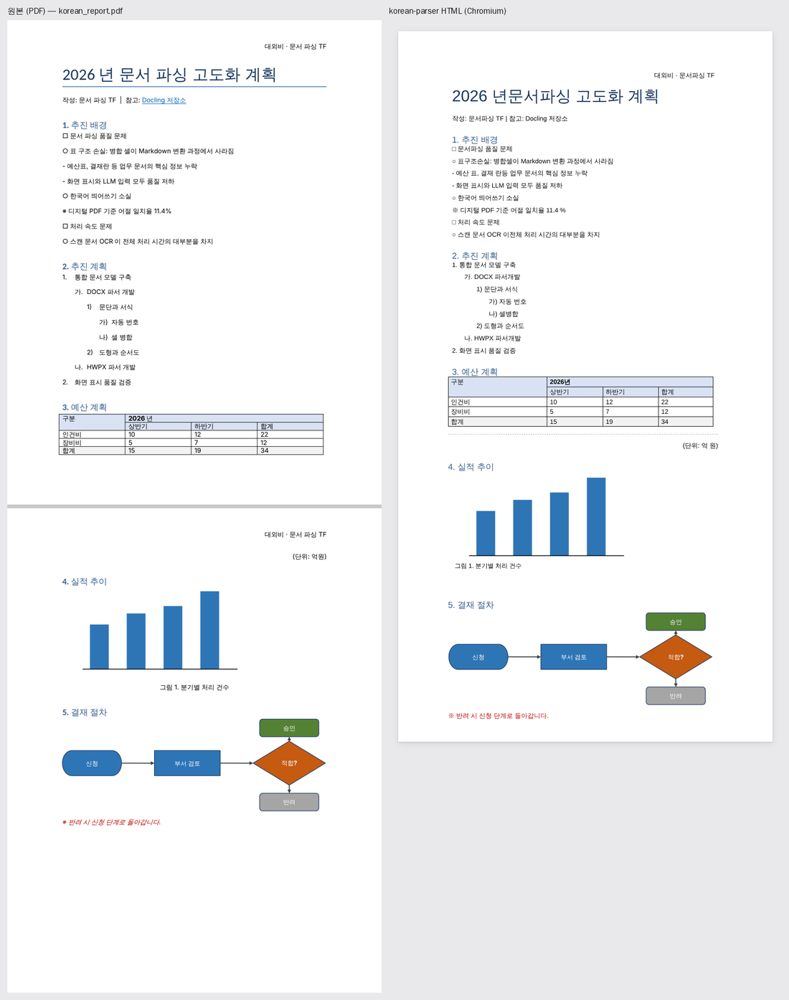
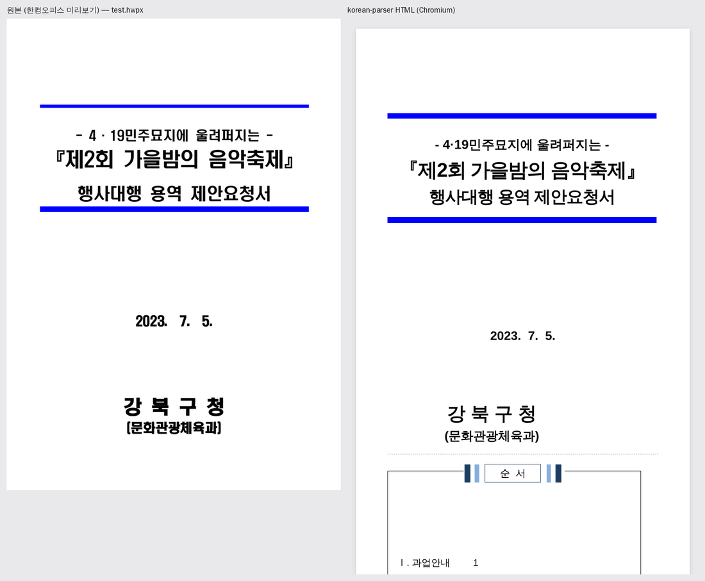
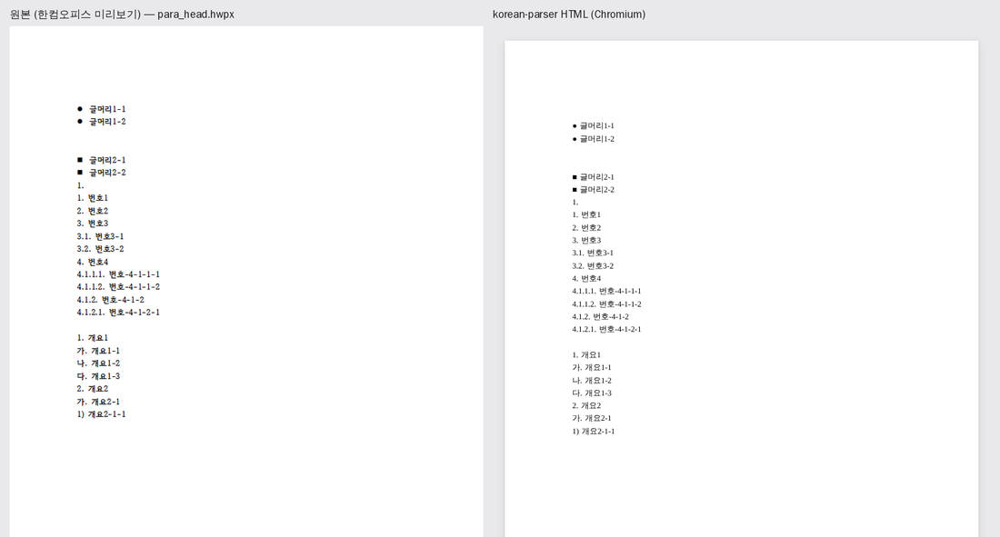
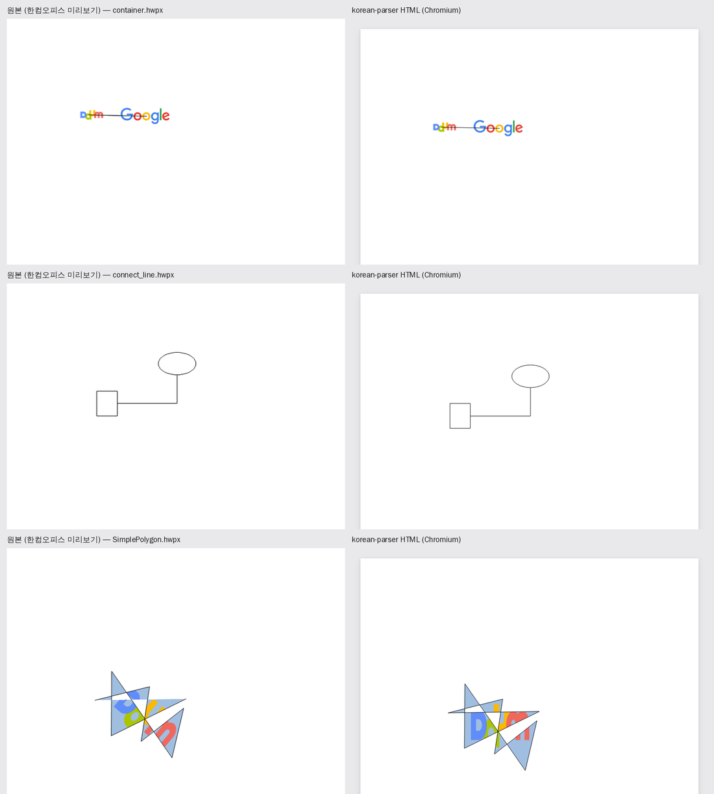

# 원본 vs HTML 시각 비교

원본 문서를 렌더링한 이미지와, `korean_parser`가 만든 HTML을 Chromium으로 캡처한 이미지를
나란히 붙인다. "후처리 없이 원본처럼 보이는가"를 눈으로 확인하는 도구다.

- DOCX: LibreOffice로 PDF 변환 후 페이지 이미지
- PDF: 그대로 페이지 이미지 (`KP_LAYOUT=flow`로 흐름형 배치 비교)
- HWPX: 파일 안의 미리보기(`Preview/PrvImage.png`). 한컴오피스가 직접 그린 첫 페이지라 가장 정확한 기준이다

```bash
pip install -e "../..[dev]" playwright
python compare.py ../../tests/fixtures/korean_report.docx -o out/
python compare.py 문서폴더/*.docx -o out/ --pages 2
```

필요: LibreOffice(`soffice`), Chromium(Playwright). LibreOffice 렌더링도 Word와 완전히 같지는 않으므로
"대략적인 기준"으로 본다.

## 예시 (PDF)

고정 배치(fixed, 기본): 글자를 지운 원본 쪽 위에 실제 글을 원래 위치로 올린다.


흐름형 배치(flow): 문서 구조대로 다시 배치한다. 글자 크기·색·표 배경은 PDF에서 복원한다.



## 예시 (HWPX)

보고서 서식 (쪽 배경 그림, 떠 있는 표, 흰 글씨 표 머리):


구청 행사 용역 제안요청서 표지:



글머리표·문단 번호·개요 번호:



그리기 개체 (묶음 개체, 꺾인 연결선, 회전한 다각형과 그림 채우기):



HWPX 예시 파일은 [hwpxlib](https://github.com/neolord0/hwpxlib) 테스트 문서(Apache-2.0)다.

## 예시 (DOCX)

한국어 보고서 (개조식, 가나다 번호, 병합 표, 이미지, 순서도):


차트 (Apache POI 테스트 문서 `61745.docx`):


떠 있는 글상자로 만든 2단 이력서 (`60316.docx`):


양식 체크박스, 기호 글꼴, 행별 테두리가 있는 신청서 (`form_footnotes.docx`):


`61745.docx`, `60316.docx`, `form_footnotes.docx`는 [Apache POI](https://github.com/apache/poi) 테스트 문서(Apache-2.0)다.
