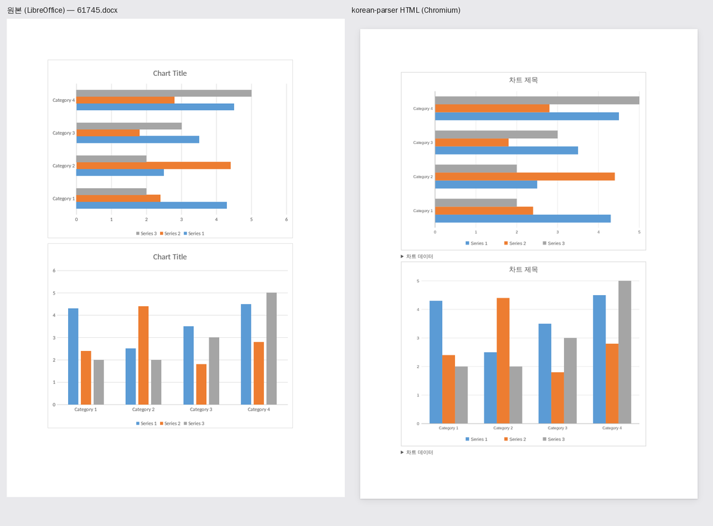
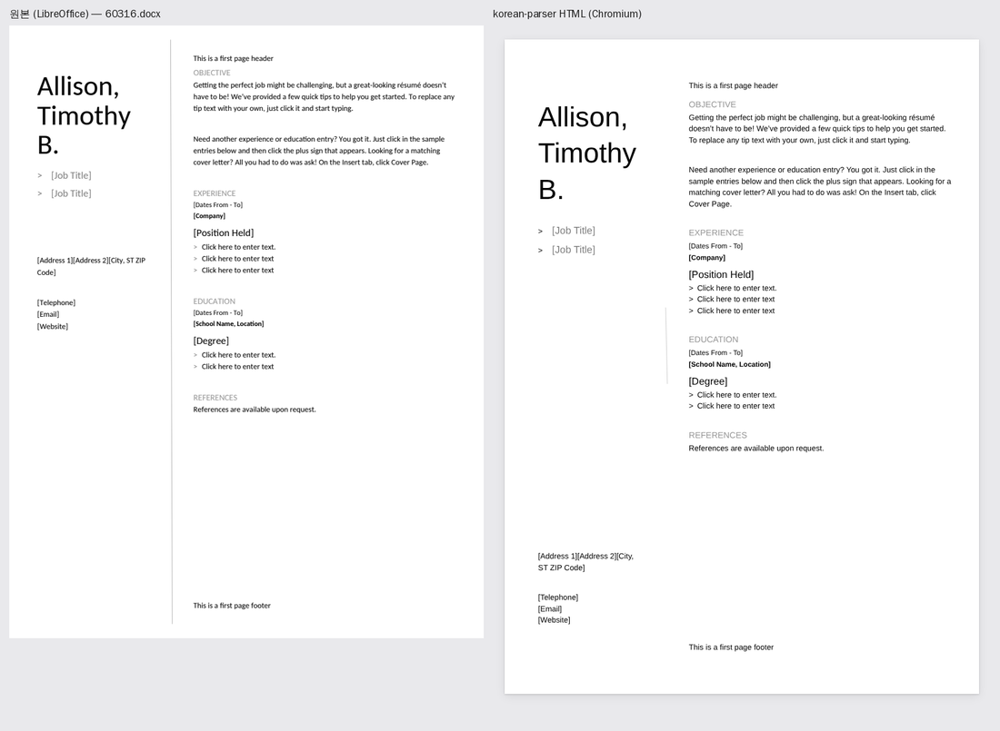
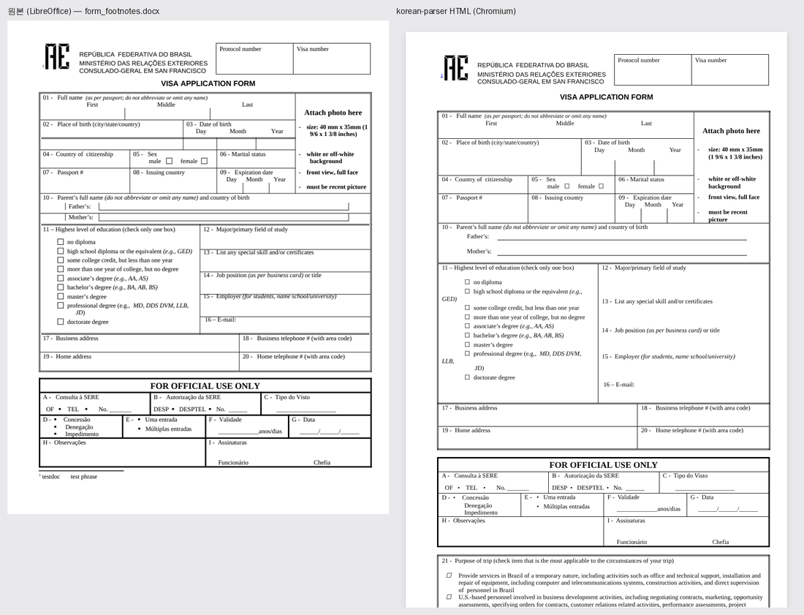

# 원본 vs HTML 시각 비교

원본 문서를 LibreOffice로 렌더링한 이미지와, `korean_parser`가 만든 HTML을 Chromium으로 캡처한 이미지를
나란히 붙인다. "후처리 없이 원본처럼 보이는가"를 눈으로 확인하는 도구다.

```bash
pip install -e "../..[dev]" playwright
python compare.py ../../tests/fixtures/korean_report.docx -o out/
python compare.py 문서폴더/*.docx -o out/ --pages 2
```

필요: LibreOffice(`soffice`), Chromium(Playwright). LibreOffice 렌더링도 Word와 완전히 같지는 않으므로
"대략적인 기준"으로 본다.

## 예시

한국어 보고서 (개조식, 가나다 번호, 병합 표, 이미지, 순서도):


차트 (Apache POI 테스트 문서 `61745.docx`):



떠 있는 글상자로 만든 2단 이력서 (`60316.docx`):



양식 체크박스, 기호 글꼴, 행별 테두리가 있는 신청서 (`form_footnotes.docx`):



`61745.docx`, `60316.docx`, `form_footnotes.docx`는 [Apache POI](https://github.com/apache/poi) 테스트 문서(Apache-2.0)다.
