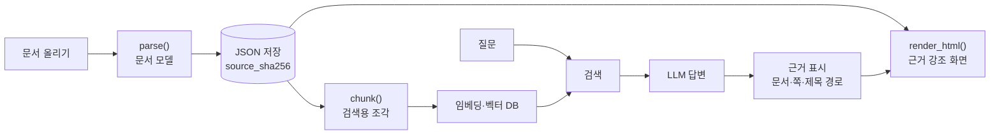

# RAG 프로그램에 붙이기

korean-parser를 검색 증강 생성(RAG) 프로그램의 문서 파싱 단계로 쓰는 방법을 적는다. 설치와 결과 형식은
[USING.md](USING.md)에 있다. 이 저장소는 파서까지만 맡는다. 임베딩·벡터 DB·검색·답변 생성은 RAG 프로그램 쪽에서 만든다
([SCOPE.md](SCOPE.md)).

- [1. 흐름](#1-흐름)
- [2. 예시 코드](#2-예시-코드)
- [3. 설계할 때 알아 둘 점](#3-설계할-때-알아-둘-점)
- [4. 다른 프로젝트의 AI에게 전하는 안내문](#4-다른-프로젝트의-ai에게-전하는-안내문)

## 1. 흐름



1. 문서를 올리면 한 번만 파싱해 문서 모델을 JSON으로 저장한다. 파싱이 가장 느린 단계다 (PDF는 쪽당 1~2초, 스캔은 더).
2. 저장한 문서 모델을 검색용 조각으로 자른다. 조각마다 제목 경로, 블록 id, 쪽 번호가 붙는다.
3. 조각의 `contextual_text()`(제목 경로를 앞에 붙인 글)를 임베딩해 벡터 DB에 넣고, `metadata()`를 함께 넣는다.
4. 답변에는 근거 조각의 문서 이름·쪽·제목 경로를 붙인다. 원본 모양 화면에서 그 블록을 강조할 수 있다.

## 2. 예시 코드

임베딩 모델과 벡터 DB는 쓰는 것으로 바꾼다. 아래 코드는 저장소의 시험 문서로 돌려 확인했다.

```python
import hashlib
from pathlib import Path

from korean_parser.chunk import chunk
from korean_parser.ir import Document
from korean_parser.parsers import DocumentError, parse
from korean_parser.render.html import render_html

STORE = Path("parsed")  # 파싱 결과 저장 폴더


def ingest(path: str) -> Document:
    """문서를 한 번 파싱해 JSON으로 저장한다. 같은 파일(같은 해시)은 저장한 결과를 다시 쓴다."""
    sha = hashlib.sha256(Path(path).read_bytes()).hexdigest()
    saved = STORE / f"{sha}.json"
    if saved.exists():
        return Document.model_validate_json(saved.read_text(encoding="utf-8"))
    try:
        doc = parse(path)
    except DocumentError as e:          # 암호화·손상·지원하지 않는 형식
        raise RuntimeError(f"문서를 열 수 없습니다: {e}") from e
    for w in doc.warnings:              # 못 읽은 것은 로그로 남긴다
        print(f"[경고] {Path(path).name}: {w}")
    STORE.mkdir(exist_ok=True)
    saved.write_text(doc.model_dump_json(), encoding="utf-8")
    return doc


def to_records(doc: Document, max_tokens: int = 500) -> list[dict]:
    """검색용 조각 → 벡터 DB에 넣을 (id, 글, 메타데이터). 리스트 값은 문자열로 편다."""
    records = []
    for c in chunk(doc, max_tokens=max_tokens):
        meta = {k: v for k, v in c.metadata().items() if v is not None}
        meta["heading_path"] = " > ".join(c.heading_path)
        meta["block_ids"] = ",".join(c.block_ids)
        meta["pages"] = ",".join(map(str, c.pages))
        meta["kinds"] = ",".join(meta["kinds"])
        records.append({"id": f"{doc.meta.source_sha256[:12]}-{c.id}", "text": c.contextual_text(), "metadata": meta})
    return records


def cite(meta: dict) -> str:
    """답변에 붙일 근거 표시: 문서 이름, 쪽, 제목 경로."""
    pages = f" {meta['pages']}쪽" if meta.get("pages") else ""
    return f"{meta['doc_source_name']}{pages} · {meta['heading_path']}"


def highlight_html(doc: Document, block_ids: list[str]) -> str:
    """원본 모양 HTML에서 근거 블록을 강조한다 (data-kp-id가 블록 id다)."""
    css = "".join(f'[data-kp-id="{b}"]{{outline:3px solid #f5a623;background:#fff6e0}}' for b in block_ids)
    return render_html(doc).replace("</head>", f"<style>{css}</style></head>", 1)


# 사용
doc = ingest("제안요청서.hwp")
for r in to_records(doc):
    vector_db.add(id=r["id"], embedding=embed(r["text"]), document=r["text"], metadata=r["metadata"])

hits = vector_db.query(embedding=embed("평가 기준은?"), top_k=5)
answer = llm(question, context=[h.document for h in hits])
sources = [cite(h.metadata) for h in hits]      # 예: "korean_report.docx · 3. 예산 계획"
```

`to_records`가 만드는 레코드 하나:

```json
{"id": "8b1e4d024580-c4",
 "text": "# 3. 예산 계획\n\n<table><tr><td rowspan=\"2\">구분</td>…</table>\n\n(단위: 억원)",
 "metadata": {"chunk_id": "c4", "heading_path": "3. 예산 계획", "block_ids": "b21,b22,b40", "pages": "",
              "kinds": "heading,paragraph,table", "tokens": 102, "doc_title": "2026년 문서 파싱 고도화 계획",
              "doc_source_name": "korean_report.docx", "doc_source_format": "docx", "doc_source_sha256": "8b1e4d02…",
              "doc_parser_version": "1.4.2", "...": "..."}}
```

## 3. 설계할 때 알아 둘 점

**조각 id**: 조각 id(`c1`, `c2` …)와 블록 id(`b1` …)는 문서 안에서만 겹치지 않는다. 여러 문서를 한 DB에 넣으면
문서 해시(`source_sha256`)를 앞에 붙인다 (위 예시의 `8b1e4d024580-c4`).

**메타데이터 모양**: `metadata()`에는 리스트(`heading_path`, `block_ids`, `pages`, `kinds`)가 있다. Chroma처럼 리스트를 받지
않는 벡터 DB에는 문자열로 펴서 넣고, 값이 `None`인 항목은 뺀다.

**조각 크기**: `max_tokens`는 임베딩 모델의 입력 한도보다 넉넉히 작게 잡는다. 토큰 수는 기본으로 어림값(한글 음절 1토큰)이다.
정확히 맞추려면 `chunk(doc, count_tokens=lambda s: len(tokenizer.encode(s)))`처럼 토크나이저를 넘긴다.
표는 통째로 두므로 큰 병합 표 하나는 상한을 넘을 수 있다.

**표**: 조각의 표는 HTML(`<table>`, `rowspan`·`colspan`)이다. 최근 LLM은 HTML 표를 잘 읽는다. 임베딩 품질이 걱정되면
임베딩할 글에서만 태그를 빼고(`re.sub(r"<[^>]+>", " ", text)`), LLM에 넘기는 글은 HTML 그대로 둔다.

**근거와 화면**: 조각의 `block_ids`는 HTML의 `data-kp-id`와 같다. PDF는 `sources[].page`·`bbox`(쪽 왼쪽 위 원점, pt)로
원본 PDF 위에 상자를 그릴 수도 있다. HWP·HWPX·DOCX는 쪽 배치가 파일에 없어 `pages`가 비어 있다.

**경고**: `doc.warnings`를 문서별로 저장해 두면, 답이 이상할 때 원인(스캔 OCR, 빠진 OLE 개체 등)을 바로 볼 수 있다.
특히 「OCR이 읽은 글 중 일부를 문서에 넣지 못했습니다」가 있는 문서는 사람이 확인한다.

**다시 파싱**: 같은 파일은 같은 결과가 나오므로 해시로 캐시한다. 파서를 새 버전으로 올리면 결과가 나아질 수 있으니
`doc_parser_version`을 저장해 두고, 필요하면 그 버전보다 오래된 문서만 다시 파싱한다.

**스캔 문서**: 글자는 정답의 95% 정도 읽지만 띄어쓰기가 완벽하지 않다 (어절 일치 0.83 안팎,
[benchmarks/eval/README.md](../benchmarks/eval/README.md)). 키워드 검색(BM25)을 함께 쓰면 띄어쓰기 차이에 덜 흔들린다.
한국어 키워드 검색은 형태소 단위로 색인하는 편이 낫다 (이 파서가 쓰는 Kiwi를 그대로 쓸 수 있다).

**파서 문제를 만나면**: 제목 경로가 틀리거나 표가 깨지거나 글이 빠지면 RAG 쪽에서 우회하지 말고, 문서 이름·증상·블록 id를
적어 이 저장소에서 고친다. 우회하면 같은 문제가 다른 문서에서 다시 나온다.

## 4. 다른 프로젝트의 AI에게 전하는 안내문

다른 프로젝트에서 AI(Claude Code 등)에게 이 파서를 붙이게 할 때 아래를 그대로 전한다.
또는 「korean-parser-all 저장소의 docs/RAG.md를 읽고 그대로 붙여」라고 한 줄만 전해도 된다.

````markdown
## 문서 파싱은 korean-parser를 쓴다

한국어 문서(HWP·HWPX·DOCX·PPTX·XLSX·PDF·스캔 PDF)는 직접 파싱하지 말고 korean-parser(v1.4.2)를 라이브러리로 쓴다.
저장소: https://github.com/somej-123/korean-parser-all (Apache-2.0). 사용법은 docs/USING.md, RAG 연결은 docs/RAG.md.

### 설치 (Python 3.10 이상, GPU 필요 없음)
- PDF·스캔까지: pip install "korean-parser[pdf] @ git+https://github.com/somej-123/korean-parser-all.git@v1.4.2"
- HWP·HWPX·DOCX·PPTX·XLSX만: [pdf]를 뺀다
- PDF는 처음 실행할 때 Docling 모델을, 스캔은 RapidOCR 모델을 내려받는다. KP_THREADS로 CPU 스레드 수를 정한다.

### 사용법
from korean_parser.parsers import parse, DocumentError
from korean_parser.chunk import chunk
from korean_parser.render.llm import render_llm
from korean_parser.render.html import render_html
from korean_parser.ir import Document

doc = parse("문서.hwp")            # 형식은 파일 내용으로 판단. 못 여는 파일은 DocumentError
doc.warnings                       # 못 읽은 것. 로그로 남긴다
for c in chunk(doc, max_tokens=500):
    c.contextual_text()            # 임베딩할 글 (제목 경로를 앞에 붙임)
    c.metadata()                   # chunk_id, heading_path, block_ids, pages, kinds, tokens, doc_* …
render_llm(doc, with_ids=False)    # 문서 전체를 LLM용 마크다운으로 (표는 HTML)
render_html(doc)                   # 원본 모양 HTML. 블록마다 data-kp-id
doc.model_dump_json() / Document.model_validate_json(s)   # 저장·다시 읽기

### 지킬 것
- 문서를 올릴 때 한 번 파싱해 JSON으로 저장하고, 조각·화면은 저장한 JSON으로 만든다. meta.source_sha256으로 캐시한다.
- 여러 문서를 한 벡터 DB에 넣으면 조각 id 앞에 문서 해시를 붙인다 (조각 id는 문서 안에서만 겹치지 않는다).
- metadata()의 리스트 값은 리스트를 못 받는 벡터 DB에 넣을 때 문자열로 펴고, None 값은 뺀다.
- 답변의 근거는 조각의 문서 이름·pages·heading_path로 표시하고, block_ids로 HTML(data-kp-id)에서 강조한다.
- 파서는 원문을 고치거나 요약하지 않는다. 분류·임베딩·검색·요약은 RAG 쪽의 몫이다.
- 파서 결과가 이상하면(제목 경로가 틀림, 표가 깨짐, 글이 빠짐) RAG 쪽에서 우회하지 말고, 문서 이름·증상·block_id를 적어
  korean-parser 저장소에 고칠 거리로 남긴다.
````
