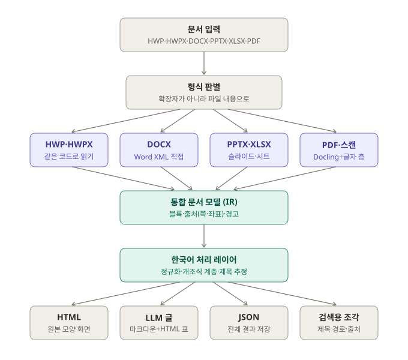

# 사용 가이드

korean-parser를 설치해서 문서를 변환하고, 결과를 읽고, 다른 프로그램에 넘기는 방법을 적는다.
RAG(검색 증강 생성) 프로그램에 붙이는 방법은 [RAG.md](RAG.md), 내부 설계는 [ARCHITECTURE.md](ARCHITECTURE.md)에 있다.

- [1. 설치](#1-설치)
- [2. 명령줄로 변환하기](#2-명령줄로-변환하기)
- [3. 파이썬에서 쓰기](#3-파이썬에서-쓰기)
- [4. 결과 네 가지](#4-결과-네-가지)
- [5. 문서 모델(JSON) 읽는 법](#5-문서-모델json-읽는-법)
- [6. 경고 읽기](#6-경고-읽기)
- [7. 속도와 운영](#7-속도와-운영)
- [8. 자주 묻는 것](#8-자주-묻는-것)



## 1. 설치

Python 3.10 이상이 필요하다. GPU는 쓰지 않는다 (CPU만으로 돈다).

| 쓰는 형식 | 설치 |
|---|---|
| HWP·HWPX·DOCX·PPTX·XLSX만 | `pip install "korean-parser @ git+https://github.com/somej-123/korean-parser-all.git@v1.4.2"` |
| PDF·스캔 PDF까지 | `pip install "korean-parser[pdf] @ git+https://github.com/somej-123/korean-parser-all.git@v1.4.2"` |
| 저장소를 받아 고쳐 가며 쓸 때 | `git clone` 뒤 `pip install -e ".[pdf]"` |

- `@v1.4.2`처럼 태그를 붙여 버전을 고정한다. 새 버전을 쓰려면 태그만 바꾼다.
- `[pdf]`를 넣으면 Docling(레이아웃 모델), pypdfium2(PDF 글자 층), onnxruntime(스캔 OCR)이 함께 깔린다. 용량이 크므로
  PDF를 읽지 않으면 빼도 된다.
- PDF는 처음 실행할 때 Docling 모델을, 스캔 PDF는 RapidOCR 한국어 모델을 내려받는다 (인터넷 필요, 한 번만).
- 환경 변수 `KP_THREADS`로 Docling이 쓰는 CPU 스레드 수를 정한다 (기본은 CPU 수).

## 2. 명령줄로 변환하기

```bash
python -m korean_parser convert 문서.hwp -o out/
python -m korean_parser convert *.pdf *.docx -o out/ --formats llm,chunks --max-tokens 500
```

설치하면 `korean-parser convert …`로도 부를 수 있다.

| 옵션 | 뜻 |
|---|---|
| `-o, --out` | 결과 폴더 |
| `--formats` | `html`, `llm`, `json`, `chunks` 중 쉼표로 고른다 (기본: html, llm, json) |
| `--max-tokens` | `chunks`의 조각 하나 토큰 상한 (어림값) |
| `--layout` | HTML 배치. `auto`(기본), `flow`(문서 흐름형), `fixed`(원본 쪽 모양, PDF·PPTX) |
| `--no-korean` | 한국어 처리 레이어(정규화, 개조식 계층, 제목 추정)를 끈다 |

`문서.hwp`를 넣으면 `out/` 아래에 이런 파일이 생긴다.

| 파일 | 내용 |
|---|---|
| `문서.html` | 원본 모양 화면 (CSS·그림이 한 파일 안에 들어 있다) |
| `문서.llm.md` | LLM에 넣는 글 |
| `문서.json` | 문서 모델 전체 |
| `문서.chunks.jsonl` | 검색용 조각 (한 줄에 조각 하나) |

## 3. 파이썬에서 쓰기

```python
from korean_parser.parsers import parse
from korean_parser.render.html import render_html
from korean_parser.render.llm import render_llm
from korean_parser.chunk import chunk
from korean_parser.ir import Document

doc = parse("문서.hwp")          # 형식은 확장자가 아니라 파일 내용으로 판단한다
print(doc.warnings)               # 못 읽은 것이 있으면 여기에 적힌다

html = render_html(doc)                         # layout="auto" | "flow" | "fixed"
text = render_llm(doc, with_ids=False)          # with_ids=True면 줄 끝에 <!-- b12 --> 블록 id
pieces = chunk(doc, max_tokens=500)             # 검색용 조각 목록

saved = doc.model_dump_json()                   # 저장
doc2 = Document.model_validate_json(saved)      # 다시 읽기 (파싱을 다시 하지 않는다)
```

| 함수 | 주요 인자 |
|---|---|
| `parse(path, korean=True, convert_images=True)` | `korean=False`면 한국어 처리 레이어를 끈다. `convert_images`는 브라우저가 못 그리는 WMF·EMF·TIFF를 PNG로 바꾼다 |
| `render_html(doc, standalone=True, layout="auto")` | `standalone=False`면 `<html>` 없이 본문 조각만 |
| `render_llm(doc, with_ids=True)` | 블록 id 주석을 붙일지 |
| `chunk(doc, max_tokens=500, min_tokens=None, count_tokens=None, include_notes=True)` | 아래 '검색용 조각' 참고 |

`parse`가 읽지 못하는 파일(암호가 걸린 문서, 배포용 문서, 손상된 파일, 지원하지 않는 형식)은 `DocumentError`
(`korean_parser.parsers`)를 낸다. 메시지는 사용자에게 그대로 보여 줄 수 있다.

## 4. 결과 네 가지

아래 예는 저장소의 시험 문서 [`tests/fixtures/korean_report.docx`](../tests/fixtures/)를 변환한 것이다.

### LLM 글 (`render_llm`, `.llm.md`)

```markdown
# 1. 추진 배경  <!-- b3 -->

□ 문서 파싱 품질 문제  <!-- b4 -->

  ○ 표 구조 손실: 병합 셀이 Markdown 변환 과정에서 사라짐  <!-- b5 -->

    - 예산표, 결재란 등 업무 문서의 핵심 정보 누락  <!-- b6 -->

# 3. 예산 계획  <!-- b21 -->

<table><tr><td rowspan="2">구분</td><td colspan="3">2026년</td></tr><tr><td>상반기</td>…</table>  <!-- b22 -->

[도식: 결재 처리 순서도]  <!-- b50 -->
- 신청
- 부서 검토
연결:
- 신청 → 부서 검토
```

- 문서 맨 앞에 제목·작성자·원본 이름이 YAML 머리말로 붙는다.
- 개조식(□ ○ -)과 한글 번호(1. 가. 1) 가))는 단계만큼 들여 쓴다.
- 병합 칸이 있는 표는 `rowspan`·`colspan`이 든 HTML 표로 쓴다. 마크다운 표로 바꾸면 병합 정보가 사라지기 때문이다.
  병합 칸이 없는 표도 같은 모양이다.
- 그림은 `[이미지 (img1)]`, 대체 텍스트가 있으면 `[이미지: 설명]`으로 쓴다. 도식(순서도·조직도)은 상자 글과 연결 관계를 쓴다.
- 수식은 `[수식: …]`, 각주·메모는 문서 끝에 `[^1]: …`로 모은다.
- 제목 상자나 강조 상자로 쓰인 한 칸짜리 표는 표가 아니라 글로 푼다.

### 검색용 조각 (`chunk`, `.chunks.jsonl`)

```json
{"id": "c4",
 "text": "# 3. 예산 계획\n\n<table>…</table>\n\n(단위: 억원)",
 "heading_path": ["3. 예산 계획"],
 "tokens": 102,
 "sources": [{"block_id": "b21", "kind": "heading"}, {"block_id": "b22", "kind": "table"},
             {"block_id": "b40", "kind": "paragraph"}],
 "block_ids": ["b21", "b22", "b40"],
 "pages": [],
 "doc": {"title": "2026년 문서 파싱 고도화 계획", "source_name": "korean_report.docx", "source_format": "docx",
         "source_sha256": "8b1e4d02…", "parser_version": "1.4.2", "page_count": 1}}
```

- 글자 수가 아니라 문서 구조로 자른다. 장(맨 위 제목)이 바뀌면 반드시 끊고, 작은 절은 같은 장 안에서 이웃과 합친다.
- 제목 경로(`heading_path`)는 제목 스타일뿐 아니라 '굵고 큰 번호 문단'(Ⅰ. 사업 개요)과 큰 글씨로만 쓴 제목으로도 만든다.
- 표는 통째로 둔다. 상한을 넘는 표만 행 경계에서 나누고, 머리 행과 세로 병합 칸을 조각마다 되풀이한다.
- 너무 긴 문단은 문장 단위로 나눈다. 조각 안에서 참조한 각주는 조각 끝에 붙인다 (`include_notes=True`).
- `pages`는 쪽을 아는 형식에서 채워진다: PDF(쪽), PPTX(슬라이드 번호), XLSX(시트 차례). PDF는 `sources`마다 `bbox`(좌표)도
  있다. HWP·HWPX·DOCX는 파일에 쪽 배치가 없어 비어 있다 (쪽은 화면에 그릴 때 정해진다).

| 인자 | 뜻 |
|---|---|
| `max_tokens` | 조각 하나의 상한. 나눌 수 없는 큰 그림·병합 표 묶음만 넘을 수 있다 |
| `min_tokens` | 이보다 작은 조각은 같은 장 안의 다음 절과 합친다 (기본: `max_tokens`의 1/4) |
| `count_tokens` | 토큰 세는 함수. 기본은 어림값(한글 음절 1토큰). 임베딩 모델의 토크나이저를 넘기면 정확해진다 |
| `include_notes` | 조각 안에서 참조한 각주 내용을 조각 끝에 붙인다 |

조각 객체의 도우미:

```python
c.contextual_text()   # "[Ⅵ. 제안안내 사항 > 2. 제안 평가 관련 사항]\n본문…"  임베딩할 글 (제목 경로를 앞에 붙임)
c.metadata()          # 벡터 DB에 함께 넣는 평평한 사전
# {"chunk_id": "c4", "heading_path": [...], "block_ids": [...], "pages": [...], "kinds": ["heading", "table"],
#  "tokens": 102, "doc_title": ..., "doc_source_name": ..., "doc_source_format": ..., "doc_source_sha256": ..., ...}
```

### HTML (`render_html`, `.html`)

- 한 파일로 끝난다 (CSS와 그림이 안에 들어 있다). 바로 브라우저로 열거나 화면에 끼워 넣을 수 있다.
- 블록마다 `data-kp-id="b22"`가 붙어 있다. 조각의 `block_ids`로 검색 결과의 근거를 화면에서 강조할 수 있다.
- 배치는 두 가지다. `flow`는 문서 구조대로 흐르는 화면(모바일, 접근성), `fixed`는 원본 쪽 모양 그대로(PDF·PPTX).
  `auto`는 PDF·PPTX면 fixed, 나머지는 flow다.

### 문서 모델 JSON (`doc.model_dump_json()`, `.json`)

모든 정보가 들어 있는 원본 결과다. 아래 5장에서 자세히 설명한다.

## 5. 문서 모델(JSON) 읽는 법

정의는 [`korean_parser/ir.py`](../korean_parser/ir.py)(pydantic)에 있다. 형식 버전은 `schema_version`이다.
필드를 더하면 두 번째 자리, 이름·뜻을 바꾸면 첫 자리가 오른다 (지금 1.5).

```text
Document
├─ schema_version   "1.5"
├─ meta             제목, 작성자, 날짜, 원본 이름·형식, source_sha256, parser_version, page_count
├─ page             쪽 크기·여백 (pt)
├─ blocks[]         본문 블록 (차례대로)
├─ header[], footer[]  머리말·꼬리말 (같은 글은 한 번). 바탕쪽 글도 여기 (style_name="master_page")
├─ notes{}          각주·미주·메모 (kind: footnote | endnote | comment). 본문의 자리에는 NoteRef
├─ images{}         그림 데이터 (base64). 블록은 image_id로 가리킨다
├─ fixed_pages[]    원본 쪽 모양 화면용 (PDF·PPTX)
└─ warnings[]       못 읽은 것
```

블록 종류(`type`):

| type | 뜻 | 주요 필드 |
|---|---|---|
| `heading` | 제목 | `level`(1~6), `inlines`, `list_info`(자동 번호) |
| `paragraph` | 문단 | `inlines`, `list_info`, `outline`(개조식 단계), `heading_guess`(제목처럼 쓰인 문단의 추정), `style_name` |
| `table` | 표 | `rows[].cells[]` (칸마다 `blocks`, `row_span`, `col_span`, `background`, `borders`). 칸 안에 표가 또 있을 수 있다 |
| `figure` | 그림 | `image_id`, `alt`, `caption`, `inner_text`(그림 안 글자, PDF) |
| `drawing` | 도식 | `shapes`(도형·글상자·연결선), `alt` |
| `chart` | 차트 | `chart_type`, `categories`, `series` |
| `page_break` | 쪽 나눔 | |

글 조각(`inlines`의 `type`): `text`(글과 `style`, `link`), `break`(줄바꿈), `tab`, `image`(글 안 그림), `note_ref`(각주·메모 자리),
`equation`(수식 `script`, `syntax`: hwp | latex | mathml).

출처(`prov`): 블록마다 `{"parser": "pdf-docling", "page": 1, "bbox": [90.1, 162.9, 163.4, 180.5]}`처럼 붙는다.
`bbox`는 쪽 왼쪽 위를 원점으로 한 (x0, y0, x1, y1), 단위 pt다. 쪽과 좌표는 PDF에서 채워지고, 다른 형식은 아는 만큼 채운다.

제목을 다룰 때 알아 둘 점:
- `heading`은 원본에 제목 정보(제목 스타일, 개요 번호, 슬라이드 제목)가 있는 것이다.
- `paragraph.heading_guess`는 원본에 제목 정보는 없지만 제목처럼 쓰인 문단이다 ("번호 'Ⅰ.' + 굵게 + 18pt (본문 11pt)",
  "큰 글씨만"). 원본을 바꾸지 않으려고 문단으로 두고 추정만 붙인다. 쓸지 말지는 쓰는 쪽이 정한다 (검색용 조각은 쓴다).

같은 파일은 언제 변환해도 같은 결과(블록 id와 좌표까지)를 낸다. 변환 시각 같은 값은 넣지 않는다.

## 6. 경고 읽기

`doc.warnings`는 원문에 있지만 결과에 넣지 못했거나 모양이 다른 것을 알린다. 경고 없이 글이 빠지는 일은 없도록 시험한다
([GOAL.md](GOAL.md) 기준 1). 자주 보는 경고:

| 경고 | 뜻 |
|---|---|
| 텍스트 레이어가 없어 OCR로 읽었습니다 … | 스캔 PDF다. 글자 서식은 없고, 글자·띄어쓰기에 OCR 오류가 있을 수 있다 |
| OCR이 읽은 글 중 일부를 문서에 넣지 못했습니다 (빠진 비율: 3쪽 25%) | 스캔에서 OCR이 읽은 글의 20% 넘게 결과에 없는 쪽이 있다. 그 쪽을 사람이 확인한다 |
| 글자 깨짐이 의심됩니다 … | 글꼴 정보가 없는 PDF라 글자 층의 글이 깨졌을 수 있다 |
| 끼워 넣은 OLE 개체(다른 파일)는 그림으로만 넣음 | 문서 안에 붙인 엑셀 표 등은 미리보기 그림만 들어갔다 |
| 숨김 서식 글 N자는 넣지 않음 | Word에서 숨김으로 지정한 글은 화면에 보이지 않으므로 넣지 않았다 |
| 숨긴 슬라이드도 넣음 (3쪽), 숨긴 시트도 넣음: … | 숨겨 둔 것도 넣었다는 안내 |
| SmartArt는 모양 없이 글만 꺼냄 | 글은 다 넣었고 모양만 없다 |
| 브라우저에서 표시할 수 없는 이미지 형식 … | PNG로 바꾸지 못한 그림이 회색 상자로 들어갔다 |

## 7. 속도와 운영

| 형식 | 걸리는 시간 (CPU) |
|---|---|
| HWP·HWPX·DOCX·PPTX | 문서 하나에 1초 안팎 (시험 문서 0.1초) |
| XLSX | 칸 수에 비례 (82만 칸 원자료 약 22초) |
| PDF | 쪽당 1~2초 + 처음 한 번 모델 로딩 (2쪽 시험 문서 첫 실행 10초) |
| 스캔 PDF | 쪽당 수 초 (OCR) |

- 문서를 올릴 때 한 번 변환해 JSON으로 저장하고, 화면·검색은 저장한 JSON으로 만든다. 같은 파일은 결과가 같으므로
  `meta.source_sha256`을 열쇠로 캐시하면 된다.
- 서버로 쓰면 Docling 모델은 처음 한 번만 올라온다. 같은 프로세스에서 여러 문서를 이어서 변환하면 빠르다.
- 파서 버전을 올리면 결과가 나아질 수 있다. `meta.parser_version`을 저장해 두면 다시 변환할 문서를 고를 수 있다.

## 8. 자주 묻는 것

**확장자가 틀린 파일은?** 내용으로 형식을 판단한다. `.hwpx`라고 붙은 PDF도 PDF로 읽고 경고를 남긴다.

**HWP와 HWPX 결과가 같은가?** 같다. HWP 바이너리를 HWPX와 같은 모양으로 옮긴 뒤 같은 코드로 읽는다.

**표 안의 표는?** 칸의 `blocks` 안에 `table`이 또 들어간다. PDF도 칸 안에 선으로 그린 작은 표를 표로 읽는다.

**메모·숨은 설명·바탕쪽은?** 메모(Word·한글·엑셀·파워포인트)와 한글 숨은 설명은 `notes`에 `kind="comment"`로,
바탕쪽 글은 머리말 뒤(`style_name="master_page"`)에 넣는다.

**원문을 고치는가?** 고치지 않는다. 문자 정규화(유니코드 NFC, 특수 공백, 가운뎃점 모양)만 한다. 띄어쓰기 복원은 원문이
손상된 PDF·스캔에서만 한다. 요약·분류·정보 추출은 하지 않는다 ([SCOPE.md](SCOPE.md)).

**한국어 처리를 끄려면?** `parse(path, korean=False)` 또는 `--no-korean`. 개조식 계층과 제목 추정이 빠진다.
